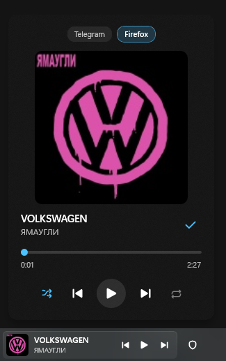

# Usagi Taskbar Island

A modular Fluent Design island for the **Windows 11 taskbar**, combining a customizable **Media Bar + Mini-Player Popup** (with two-way VK Music sync) and a passwordless **WireGuard VPN toggle** with per-app **Split Tunneling**.

> 🌐 [Русская документация](#русская-документация) · 📦 Built for [Windhawk](https://windhawk.net/)

<!-- Add screenshots here (e.g. ) -->

---

## Repository Contents

- [`vk-music-bridge.user.js`](./vk-music-bridge.user.js) — Browser userscript (Violentmonkey / Tampermonkey) that bridges Shuffle, Repeat, and Add/Remove from Library with VK Music (`vk.com`, `vk.ru`, `music.vk.com`).
- `usagi-taskbar-island.wh.cpp` *(optional mirror)* — Source code of the Windhawk mod submitted to [`ramensoftware/windhawk-mods`](https://github.com/ramensoftware/windhawk-mods).

---

## Key Features

- **Taskbar Island (`Island`):**
  - Unified pill or separate capsules (Media Bar & VPN apart) on any taskbar edge (`Left edge`, `Center`, `Right edge`, `System Tray Left/Right`).
  - Full multi-monitor support: target a specific monitor (`Island → Monitor number`, `1` = Primary) or show on **All monitors**.
  - Surface customization: `Transparent`, `Solid color`, or Windows 11 `Acrylic glass`, corner radius, paddings, border, and `ThemeShadow`.
- **Media Bar & Mini-Player (`MediaBar`, `MiniPlayer`):**
  - Album cover art (square or adaptive aspect ratio), track title & artist (with optional smooth marquee scrolling), Prev / Play-Pause / Next, plus optional Shuffle, Repeat, and Library buttons.
  - Native Windows 11 tile hover highlight, mouse wheel shortcuts (next/prev track or switch media source), and right-click context menu.
  - Left-clicking track info or cover opens a borderless **Translucent** / **Fluent Acrylic** / **Solid** Mini-Player popup with adaptive art proportions, interactive seek bar, and multi-session switcher (cleanly mapping browser AUMIDs like Firefox, Chrome, Edge, Opera, Yandex).
- **WireGuard VPN Toggle (`VpnConnection`, `VpnAppearance`):**
  - One-click **passwordless** (no UAC prompt) connect/disconnect via Windows Task Scheduler (`WindhawkVPN_Start` / `WindhawkVPN_Stop`), supporting both WireGuard and AmneziaWG tunnel services.
  - 11 built-in SVG icons, per-state HEX/RGB/`auto` icon colors, customizable label text, status dot, and optional tray notifications.
- **Split Tunneling (`SplitTunneling`):**
  - Lightweight Winsock bypass routing selected executables, process stems, or folders directly through your physical network adapter outside the VPN tunnel, with optional IPv6 blocking to prevent IPv6 leaks.
- **VK Music Bridge (`vk-music-bridge.user.js`):**
  - Standard Windows media controls (SMTC) do not expose VK's Shuffle, Repeat, or Add-to-Library state. The companion userscript syncs them over localhost (`127.0.0.1:49321`) with multi-tab leader election.

---

## Installation

### 1. Install the Windhawk Mod
1. Install [Windhawk](https://windhawk.net/).
2. Open **Explore**, search for **Usagi Taskbar Island**, and click **Install**. *(Or paste the source code when creating a local mod).*

### 2. Install VK Music Bridge *(Optional — for VK Music Shuffle / Repeat / Library)*
1. Install **Violentmonkey** or **Tampermonkey** in your browser (Firefox, Chrome, Edge, Opera, Yandex, etc.).
2. Click the direct raw install link below — your userscript manager will prompt to install automatically:

   👉 **[Install `vk-music-bridge.user.js`](https://raw.githubusercontent.com/usagi-dead/usagi-taskbar-island/main/vk-music-bridge.user.js)**

3. Ensure `MediaBar → Style, controls & VK Bridge → Enable VK Music HTTP Bridge` is enabled (`true`, port `49321`).
4. Refresh open VK tabs (`F5`). Only the active playing tab polls the bridge (`localStorage` leader election).

### 3. Configure WireGuard VPN *(Optional — No UAC Toggle)*
> If you only need the Media Player, disable `Island → Enable VPN button module` in mod settings.

1. Install [WireGuard for Windows](https://www.wireguard.com/install/) (or AmneziaWG) and place your `.conf` file in a permanent folder (e.g. `C:\WireGuard\my-vpn.conf`).
2. Open **Mod Settings → VPN — Connection & Behavior**:
   - Check **Path to `wireguard.exe`** (default: `C:\Program Files\WireGuard\wireguard.exe`).
   - Enter the full path in **Path to `.conf` file**.
   - Save settings.
3. **Right-click** the VPN button on the taskbar → select **"Setup / update passwordless toggle (1 time)"** and approve the single UAC prompt.
4. All future left-clicks will toggle VPN silently without UAC. Run that menu item again if you ever move or rename your `.conf` file.

### 4. Configure Split Tunneling *(Optional)*
1. Open **Mod Settings → Split Tunneling** and enable **Enable Split Tunneling**.
2. Add rules to **Excluded applications** and check **Enabled** on each:
   - Exact executable: `firefox.exe`
   - Process stem: `steam`
   - Folder path: `C:\Games\`
3. Save settings and **restart** any newly added applications so the bypass hook attaches.
4. *(Optional Security Tip)* Because Split Tunneling uses `@include *` with system exclusions, if Windows Smart App Control / Code Integrity logs blocked unsigned DLL loads in unrelated third-party apps, you can open Windhawk's **Advanced** tab for the mod and limit **Custom process inclusion list** strictly to `explorer.exe` plus your excluded apps.

---

## Controls & Multi-Monitor Tips
- **Left-click album art / track title:** Toggle Mini-Player popup.
- **Right-click Media Bar:** Full playback context menu (Play/Pause, Next/Prev, Stop, -/+5s, Shuffle, Repeat `Off / Playlist / One track`, Add/Remove VK Library, active session switcher).
- **Left-click VPN button:** Connect / Disconnect VPN.
- **Right-click VPN button:** Connect/Disconnect, Setup passwordless task, Open WireGuard, Open `.conf`.
- **Multi-monitor:** Default is **Monitor `1` (Primary)**. Set `Island → Monitor number` to `2` (etc.) or set `Monitor display mode` to `All monitors`.

---

## Русская документация

Модульный островок в стиле **Fluent Design** для **панели задач Windows 11**. Объединяет настраиваемый **Медиаплеер** со всплывающим окном полного просмотра и кнопку **WireGuard VPN** с переключением без UAC и раздельным туннелированием (Split Tunneling).

### Содержимое репозитория
- [`vk-music-bridge.user.js`](./vk-music-bridge.user.js) — юзерскрипт для **Violentmonkey / Tampermonkey**, который синхронизирует кнопки `Перемешать`, `Повтор` и `Добавить/убрать из библиотеки` на `vk.com`, `vk.ru` и `music.vk.com`.
- `usagi-taskbar-island.wh.cpp` *(опционально)* — исходный код мода Windhawk (основная публикация — в официальном каталоге [`ramensoftware/windhawk-mods`](https://github.com/ramensoftware/windhawk-mods)).

### Основные возможности
- **Островок (`Island`):** единая капсула или раздельные модули, выбор монитора (`1` — основной, `2`, или все мониторы), любая позиция на панели (`Левый край`, `Центр`, `Правый край`, `Трей`), стили фона (`Прозрачный`, `Сплошной`, `Acrylic`), скругление, рамки и тень `ThemeShadow`.
- **Медиаплеер и мини-плеер (`MediaBar`, `MiniPlayer`):** обложка (квадратная или адаптивная `1:1`/`16:9`), название и автор (опционально бегущая строка), управление воспроизведением, нативный hover Win11, действия колеса мыши, контекстное меню ПКМ и безрамочное окно полного просмотра (`Translucent` / `Acrylic` / `Сплошной`) с перемоткой и выбором источника медиа.
- **Кнопка WireGuard VPN (`VpnConnection`, `VpnAppearance`):** включение/выключение без запроса UAC через Планировщик заданий (`WindhawkVPN_Start` / `WindhawkVPN_Stop`), совместимость с WireGuard и AmneziaWG, 11 SVG-иконок с отдельным выбором цвета для каждого статуса, текст, точка-индикатор и уведомления.
- **Раздельное туннелирование (`SplitTunneling`):** пускает указанные приложения или папки в сеть напрямую через физический адаптер в обход VPN (с опциональной блокировкой IPv6 от утечек).

### Установка и настройка

#### 1. Установка мода Windhawk
1. Установите [Windhawk](https://windhawk.net/).
2. Откройте вкладку **Explore**, найдите **Usagi Taskbar Island** и нажмите **Install**.

#### 2. Подключение моста ВК Музыки *(для Шафла, Повтора и Библиотеки)*
1. Установите расширение **Violentmonkey** или **Tampermonkey** в браузер.
2. Установите скрипт в 1 клик по прямой ссылке:

   👉 **[Установить `vk-music-bridge.user.js`](https://raw.githubusercontent.com/usagi-dead/usagi-taskbar-island/main/vk-music-bridge.user.js)**

3. Убедитесь, что в настройках мода включена опция `Включить мост ВК Музыки` (порт по умолчанию `49321`).
4. Обновите открытые вкладки VK (`F5`). При нескольких открытых вкладках активной автоматически выбирается вкладка с играющей музыкой (`localStorage`).

#### 3. Настройка WireGuard VPN без UAC *(если нужен VPN-модуль)*
> Если вам нужен только медиаплеер — отключите `Island → Включить модуль кнопки VPN` в настройках мода.

1. Установите [WireGuard для Windows](https://www.wireguard.com/install/) (или AmneziaWG) и сохраните свой `.conf` файл (например, `C:\WireGuard\my-vpn.conf`).
2. Откройте **Настройки мода → VPN — Подключение и поведение**:
   - Проверьте **Путь к `wireguard.exe`** (`C:\Program Files\WireGuard\wireguard.exe`).
   - Укажите полный путь в **Путь к файлу `.conf`**.
   - Сохраните настройки.
3. Нажмите **ПКМ** по кнопке VPN на панели задач → выберите **«Настроить / обновить запуск без UAC (1 раз)»** и один раз подтвердите UAC. Дальше VPN будет переключаться по ЛКМ без окон UAC.

#### 4. Настройка Split Tunneling *(опционально)*
1. В разделе **Split Tunneling** включите **Включить раздельное туннелирование**.
2. В списке **Исключённые приложения** добавьте нужные правила (имя exe вроде `firefox.exe`, имя без `.exe` вроде `steam` или папку `C:\Games\`) и поставьте галочку **Включено**.
3. Сохраните настройки и **перезапустите** добавленные программы.
4. *(Совет по безопасности)* Во вкладке **Дополнительно** (Advanced) настроек мода в Windhawk можно задать свой список включения процессов (`explorer.exe` + приложения из Split Tunneling), чтобы мод вообще не загружался в посторонние программы.

### Управление и мультимониторность
- **ЛКМ по обложке / названию:** открыть/закрыть окно полного просмотра.
- **ПКМ по плееру:** полное меню управления, выбор режима повтора (`Выкл` / `Плейлист` / `Один трек`), библиотека ВК и переключение источника медиа.
- **ЛКМ по VPN:** включить/выключить туннель. **ПКМ по VPN:** меню с настройкой задач без UAC и быстрым открытием WireGuard / `.conf`.
- **Второй монитор:** по умолчанию выбран **монитор `1`**. Чтобы перенести островок, измените `Island → Номер монитора` на `2` или выберите `Все мониторы`.

---

## License

[MIT License](https://opensource.org/licenses/MIT)
